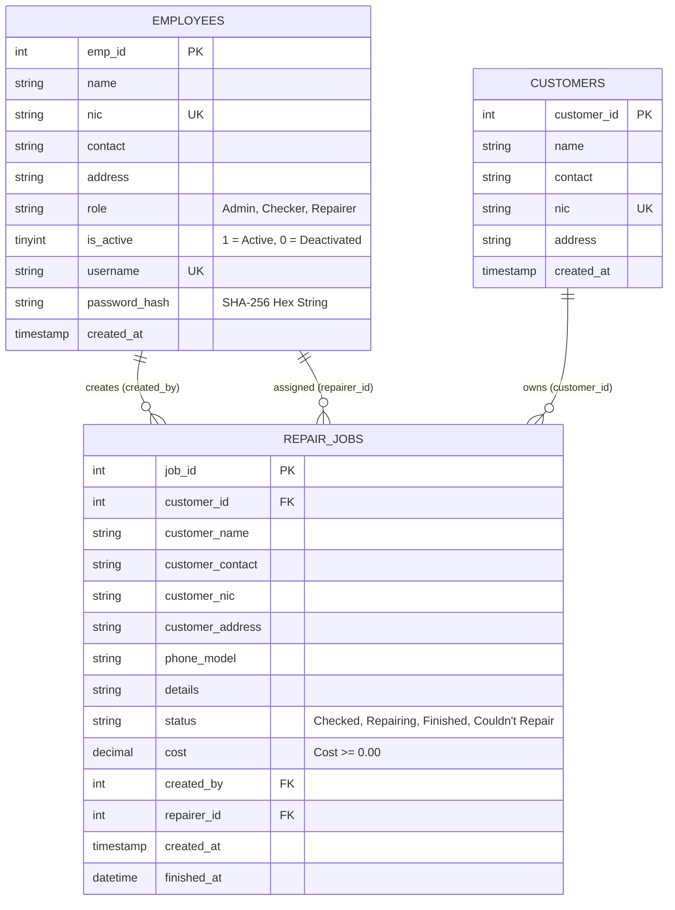
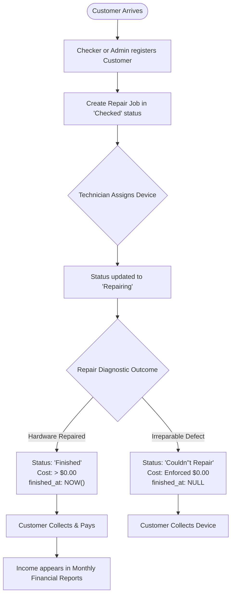

# FixSphere — Mobile Phone Repair Center Management System
## Comprehensive University Software Development Documentation

---

### Project Information
* **Application Title:** FixSphere — Mobile Phone Repair Center Management System
* **Target Audience:** University Examination & Software Assessment Board
* **Development Platform:** Microsoft Windows Desktop (x64)
* **Framework:** C++/CLI on .NET Framework v4.7.2
* **GUI Subsystem:** Windows Forms (`System.Windows.Forms`)
* **Database Engine:** MySQL Community Server 8.0+
* **Database Connector:** MySQL ADO.NET Connector (`MySql.Data.dll` v8.0.30)
* **Design Palette:** Primary Navy (`#1D3557`), Secondary Blue (`#457B9D`), Light Cyan (`#A8DADC`), Neutral Background (`#F4F6F9`)

---

## 1. Executive Summary & Problem Statement

Mobile phone repair service centers deal with daily device intake, multi-step technician repairs, inventory tracking, customer communication, and financial accounting. Often, smaller centers rely on paper job cards or fragmented spreadsheets, which lead to:
1. Lost device history and untracked repair progress.
2. Inaccurate income reporting and missing technician accountability.
3. Lack of security where all staff members can modify financial records or delete jobs.

**FixSphere** resolves these challenges by providing a genuine, high-performance desktop application built in C++ and Windows Forms. FixSphere introduces strict **Role-Based Access Control (RBAC)**, an intake-to-completion repair tracking lifecycle, customer directory synchronization, secure SHA-256 credential management, and calendar-month revenue reporting with CSV export.

---

## 2. Technology Stack & Architectural Decision Record (ADR)

### ADR-01: Why C++/CLI Windows Forms?
* **Requirement:** The university project required a genuine C++ desktop application with a Windows Forms GUI without relying on web technologies (Electron, HTML/CSS) or foreign languages (C#, Java, Python).
* **Technical Reality:** Native ISO standard C++ does not provide built-in Windows Forms libraries. In Microsoft Visual Studio, the official and supported architecture to create Windows Forms applications using C++ is **C++/CLI (.NET Framework v4.7.2)**.
* **Result:** FixSphere uses modern C++/CLI with managed pointers (`^`), reference classes (`ref class`), and direct calls to the Windows desktop subsystem.

### ADR-02: Database Connectivity & Security
* **Connector Choice:** Instead of unmaintained native ODBC bridges or heavy X DevAPI libraries, FixSphere leverages the robust, industry-standard `MySql.Data.dll` ADO.NET provider.
* **Separation of Concerns:** All database interactions are encapsulated inside [`DatabaseService.h`](file:///c:/Users/Pentiumcity/Downloads/FixSphere/FixSphere/DatabaseService.h).
* **Credential Isolation:** Database credentials (host, port, user, password, database) are read at runtime from a local [`db_config.ini`](file:///c:/Users/Pentiumcity/Downloads/FixSphere/FixSphere/db_config.ini) configuration file that is git-ignored, preventing hardcoded credentials in source control.
* **SQL Injection Prevention:** Every database query in FixSphere uses strictly parameterized prepared statements (`@param`) with clean parameter binding. User input is never concatenated directly into SQL queries.

---

## 3. Database Architecture & Data Dictionary

### Database Entity-Relationship Diagram

### Data Dictionary

#### 1. `employees` Table
| Column Name | Data Type | Constraints | Description |
| :--- | :--- | :--- | :--- |
| `emp_id` | INT | PRIMARY KEY, AUTO_INCREMENT | Unique employee identifier |
| `name` | VARCHAR(100) | NOT NULL | Employee's full name |
| `nic` | VARCHAR(12) | NOT NULL, UNIQUE | National Identity Card number |
| `contact` | VARCHAR(10) | NOT NULL | 10-digit mobile contact number |
| `address` | VARCHAR(255) | NOT NULL | Residential address |
| `role` | VARCHAR(10) | NOT NULL | Role: `Admin`, `Checker`, or `Repairer` |
| `is_active` | TINYINT(1) | NOT NULL, DEFAULT 1 | 1 for active account, 0 for deactivated |
| `username` | VARCHAR(50) | NOT NULL, UNIQUE | Login handle |
| `password_hash`| CHAR(64) | NOT NULL | 64-character SHA-256 hexadecimal hash |
| `created_at` | TIMESTAMP | DEFAULT CURRENT_TIMESTAMP | Account creation timestamp |

#### 2. `customers` Table
| Column Name | Data Type | Constraints | Description |
| :--- | :--- | :--- | :--- |
| `customer_id` | INT | PRIMARY KEY, AUTO_INCREMENT | Unique customer identifier |
| `name` | VARCHAR(100) | NOT NULL | Customer's full name |
| `contact` | VARCHAR(10) | NOT NULL | Contact telephone number |
| `nic` | VARCHAR(12) | NOT NULL, UNIQUE | Unique national ID number |
| `address` | VARCHAR(255) | NOT NULL | Customer address |
| `created_at` | TIMESTAMP | DEFAULT CURRENT_TIMESTAMP | Registration timestamp |

#### 3. `repair_jobs` Table
| Column Name | Data Type | Constraints | Description |
| :--- | :--- | :--- | :--- |
| `job_id` | INT | PRIMARY KEY, AUTO_INCREMENT | Unique repair job reference |
| `customer_id` | INT | FOREIGN KEY (`customers`) | Reference to registered customer |
| `customer_name`| VARCHAR(100) | NOT NULL | Customer name at time of intake |
| `customer_contact`| VARCHAR(10)| NOT NULL | Customer phone number |
| `customer_nic` | VARCHAR(12) | NOT NULL | Customer national identity number |
| `customer_address`| VARCHAR(255)| NOT NULL | Customer physical address |
| `phone_model` | VARCHAR(100) | NOT NULL | Brand & model (e.g., iPhone 13, Pixel 7) |
| `details` | TEXT | NOT NULL | Customer-reported defect & physical condition |
| `status` | VARCHAR(20) | NOT NULL, DEFAULT 'Checked'| Status: `Checked`, `Repairing`, `Finished`, `Couldn't Repair` |
| `cost` | DECIMAL(10,2)| NOT NULL, DEFAULT 0.00 | Repair cost in currency |
| `created_by` | INT | FOREIGN KEY (`employees`) | Staff member who accepted the job |
| `repairer_id` | INT | FOREIGN KEY (`employees`) | Assigned technician |
| `created_at` | TIMESTAMP | DEFAULT CURRENT_TIMESTAMP | Date and time received |
| `finished_at` | DATETIME | NULL | Timestamp when marked `Finished` |

---

## 4. Role-Based Access Control (RBAC) Matrix

FixSphere enforces strict permission separation in the UI and business logic layer:

| Feature / Screen | Admin | Checker | Repairer |
| :--- | :---: | :---: | :---: |
| **Login & Profile Authentication** | Yes | Yes | Yes |
| **Dashboard Overview & Metrics** | Full (with Revenue) | View (without Revenue) | View (without Revenue) |
| **Register & Edit Customers** | Yes | Yes | No |
| **Search Customer Directory** | Yes | Yes | No |
| **Create New Repair Job (Intake)**| Yes | Yes | No |
| **View & Filter Repair Jobs** | All Jobs | All Jobs | Assigned Jobs & Details |
| **Update Repair Status (`Repairing`, etc.)**| Yes | No | Yes |
| **Mark as `Finished` / `Couldn't Repair`**| Yes | No | Yes |
| **Delete Repair Jobs** | Yes (With Confirmation) | No | No |
| **Employee & User Account Management**| Full Access | Hidden | Hidden |
| **Reset Passwords & Activate/Deactivate**| Yes | Hidden | Hidden |
| **Monthly Income & Financial Reports** | Full Access | Hidden | Hidden |
| **Export Financial Data to CSV** | Yes | Hidden | Hidden |

---

## 5. Core Business Workflows

### 1. Repair Job Lifecycle Flowchart

### 2. Business Rules Enforced by Code:
1. **Unrepairable Zero-Cost Rule:** Any job marked `Couldn't Repair` must have a repair cost of `$0.00`. If a user attempts to enter a non-zero cost, the system displays a business rule violation error and resets the cost to `$0.00`.
2. **Completed Job Cost Rule:** A `Finished` job must have a non-negative repair cost and automatically records `finished_at = NOW()`.
3. **Revenue Isolation:** Unfinished jobs (`Checked`, `Repairing`) and failed jobs (`Couldn't Repair`) are strictly excluded from monthly income metrics.
4. **Prevent Admin Self-Lockout:** An administrator cannot deactivate their own logged-in account.
5. **Duplicate NIC Prevention:** Customer registration enforces unique national identity numbers to maintain clean database records.

---

## 6. System Demonstration & Viva Voce Guide

### Demonstration Script (For Examiner Presentation)

#### Step 1: Login & Role Security (1 Minute)
* Launch `FixSphere.exe`.
* Attempt to log in with an incorrect password to demonstrate error handling.
* Log in as `repairer` (Password: `repair123`).
  * Point out that **"Customers"**, **"Employees"**, and **"Reports & Income"** are hidden from the sidebar.
  * Show that the technician can only inspect phones and update job statuses.
* Click **"Sign Out"**.

#### Step 2: Customer Registration & Job Intake as Checker (2 Minutes)
* Log in as `checker` (Password: `check123`).
* Open **"Customers"** and register a new customer:
  * Name: `Sunil Wickramasinghe`
  * Contact: `0779988776`
  * NIC: `198512345678`
  * Address: `Kandy`
* Open **"Repair Jobs"** and register a new intake:
  * Select Customer `Sunil Wickramasinghe`.
  * Phone Model: `Samsung Galaxy S22`.
  * Details: `Broken charging port; battery drains rapidly`.
  * Assigned Repairer: `Nimal Silva (Repairer)`.
  * Initial Status: `Checked`. Initial Cost: `$0.00`.
  * Save the job.

#### Step 3: Technician Repair & Completion (2 Minutes)
* Log in as `repairer` (`repair123`) or `admin` (`admin123`).
* Select the newly created Samsung Galaxy S22 job from the table.
* Change status to `Repairing`. Click **"Update Status"**.
* Change status to `Finished`, enter cost `7500.00`, and click **"Update Status"**.
* Show that the job is now recorded as finished with timestamp.

#### Step 4: Administrator Financial Reports & CSV Export (2 Minutes)
* Log in as `admin` (Password: `admin123`).
* Open **"Dashboard Overview"**:
  * Show the live KPI cards updating dynamically from MySQL data.
* Open **"Reports & Income"**:
  * Point out the updated Total Monthly Income and Finished Jobs Count.
  * Filter by `October 2026` and click **"Generate Report"**.
  * Click **"Export to CSV"**, save to disk, and open the `.csv` file in Excel or Notepad to display the formatted headers and itemized records.

#### Step 5: Employee Management & Secure Password Reset (1 Minute)
* Open **"Employees"** (Admin-only).
* Show search by role and keyword.
* Show the secure SHA-256 password reset feature (no passwords displayed as plaintext or hashes).
* Show account activation/deactivation toggle.

---

## 7. Frequently Asked Questions (Viva Voce Preparation)

**Q1: Why did you use C++/CLI instead of pure native ISO C++?**  
*Answer:* Pure native ISO standard C++ has no native concept of Windows Forms or the .NET GUI framework. While native C++ can use raw Win32 API (`CreateWindowEx`) or MFC, Windows Forms in Visual Studio is architecturally a .NET technology. Microsoft Visual Studio provides **C++/CLI** as the official, native bridge that allows writing authentic C++ code while accessing the rich Windows Forms controls and modern libraries.

**Q2: How do you prevent SQL Injection attacks?**  
*Answer:* We completely avoid string concatenation for SQL queries. All database operations in `DatabaseService.h` and `MainForm.h` use parameterized queries with `MySqlCommand::Parameters->AddWithValue()`. The MySQL engine compiles the SQL query plan before parameters are injected, ensuring malicious input is treated purely as data, not executable code.

**Q3: Where and how are passwords stored?**  
*Answer:* Passwords are never stored in plaintext. FixSphere uses SHA-256 cryptographic hashing (`System::Security::Cryptography::SHA256`). When a user inputs a password during login, it is hashed and compared against the stored 64-character hexadecimal hash in the MySQL `employees.password_hash` column (`SHA2(password, 256)`).

**Q4: How does FixSphere prevent duplicate counting in the Monthly Income report?**  
*Answer:* The report query strictly filters on `status = 'Finished'` and groups each unique `job_id`. Unfinished jobs (`Checked`, `Repairing`) and failed jobs (`Couldn't Repair`) are excluded. The calendar month filter evaluates `MONTH(finished_at) = @month AND YEAR(finished_at) = @year`, ensuring only jobs completed within that exact month are included.

**Q5: How does the application connect to MySQL on a new computer?**  
*Answer:* All connection parameters are externalized in `db_config.ini` (`server`, `port`, `database`, `user`, `password`). To run on an examiner's machine, one simply imports `setup_database.sql` into MySQL Workbench and configures the credentials in `db_config.ini` without recompiling any code.
